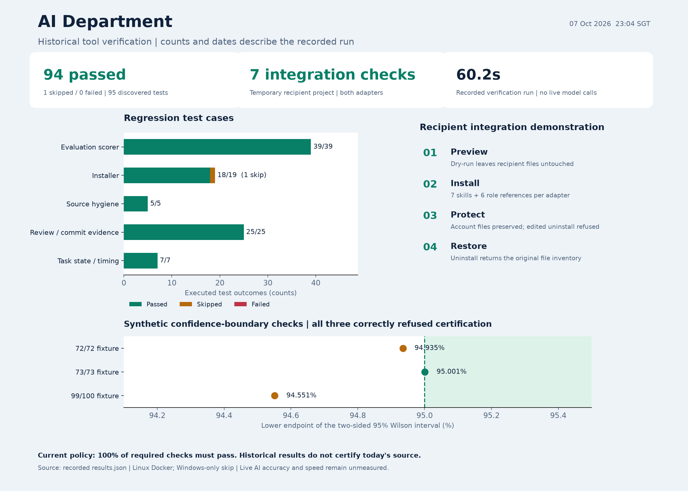

# AI Department

A shared AI development environment built from our current Frank agents and skills, optimized for engineering, research, design and evidence-based AI evaluation. Works with Claude Code and Codex without copying private account settings or service-specific release configuration.

The foundation keeps our four core skills, adds three targeted domain skills and expands the six original Frank roles into twelve department roles, including a dedicated designer. It provides a safe installer, strict review/commit evidence, task timing and offline benchmarking. Smaller changes get smaller review scope; substantive engineering still keeps independent correctness, QA and security.

## Autonomous development flow


Open the [full autonomous pipeline PNG](docs/autonomous-development-flow.png) or [vector SVG](docs/autonomous-development-flow.svg) if the inline image does not display. Read the [step-by-step process](docs/autonomous-development.md) and its [owning skill](skills/autonomous-development/SKILL.md).

Context loads only when needed. One QA owner coordinates affected checks; small substantive changes keep three independent review lenses with focused scope. Blockers become one repair brief, with at most two automatic fix rounds before diagnosis and replanning. Delivery stops at the authorized local or remote target.

## Observed verification



Read the [verification report](docs/verification/2026-10-07/report.md) and inspect [machine-readable results](docs/verification/2026-10-07/results.json). These are actual tool/fixture checks; live AI accuracy, token savings and production speed remain unmeasured.

The [department expansion checks](docs/verification/2026-10-07-department/report.md) verify the current twelve-role installation and global user-scope lifecycle. The earlier chart above describes its recorded earlier source inputs.

Use the [resource catalog](docs/resources.md), [connection runbook](docs/connections.md) and [optimization guide](docs/optimization.md) to turn skills into repeatable work with actual tools and evidence.

See the [department roles and handoffs](skills/frank/references/department.md) and [current tooling research](docs/tooling-landscape-2026-10.md). Extra roles run only when needed; installing role definitions does not prove live AI performance.

Start with the [plain-language setup and usage guide](docs/getting-started.md).

Download the [PDF guide](docs/ai-department-guide.pdf) to share or print.

## Department roles and handoffs


## Start

Prerequisites: Python 3.11+ and Git; a working Claude Code/Codex account for actual AI work; Docker for this repository's checks. The toolkit never installs credentials or selects a paid model.

Clone this repository and preview installation into your project:

```text
python scripts/install.py install --assistant both --scope project --target <project-root>
python scripts/install.py install --assistant both --scope project --target <project-root> --apply
```

Default is dry-run. Existing conflicts are refused; --replace with --apply backs up originals. Updates preserve those originals, and uninstall restores them only when owned installed files remain unchanged:

Applied operations acquire one target-wide OS lock before planning. Concurrent writers wait briefly or refuse without changing assets; crashes release the lock. The small .ai-department/install.lock file remains after uninstall so waiting processes retain the same lock identity. Do not remove it while installers are running.

```text
python scripts/install.py uninstall --assistant both --scope project --target <project-root>
python scripts/install.py uninstall --assistant both --scope project --target <project-root> --apply
```

For personal cross-project use set --scope user and --target to your own home directory. Project/user paths use .claude/skills and .claude/agents for Claude, .agents/skills for Codex. Ownership/backups stay under .ai-department within the explicit target. Files are copied, not symlinked; Windows paths with spaces work when quoted.

Global setup uses the same installer with user scope:

```text
python scripts/install.py install --assistant both --scope user --target <home-directory>
python scripts/install.py install --assistant both --scope user --target <home-directory> --apply
```

Replace the placeholder with your own home directory and quote paths containing spaces. Global skills/role references are available across projects after assistant discovery in a new session. Root global instructions still require the manual import described below. Keep shared methods global; retain project business rules, environment commands, permissions and private memory at project scope. Avoid installing duplicate copies at both scopes unless you deliberately manage precedence; project copies can shadow later global updates.

Installer writes shared guidance into .claude/ai-department.md and .codex/ai-department.md. Manually import/merge it into your existing CLAUDE.md/AGENTS.md at the chosen scope; root instructions and account configuration are intentionally preserved. Fill templates/project-CLAUDE.md with your actual environment/commands/runbook, and use templates/project-memory-MEMORY.md for scoped knowledge. Native instruction/discovery paths were verified against official documentation on 07 October 2026; see docs/research-sources.md.

Start a new assistant session in the target project and confirm seven skills and twelve Frank role definitions are available. Claude roles are native agent definitions; Codex uses native workers given the installed skill-contained role references. Account access, browser tools and third-party plugin availability require a recipient smoke check; deterministic installation tests cannot prove live model behavior.

## Work

| Task | Relevant skill |
| --- | --- |
| Feature, fix or unfinished delivery | autonomous-development + craftsman |
| Specialist routing/engineering partner | frank |
| Commit or PR text | commit-pr-standard |
| Source-backed investigation/AI approach comparison | research-workflow |
| UI/UX, accessible states and prototypes | design-workflow |
| Prompt/model/retrieval/agent quality measurement | ai-evaluation |

Use a concrete brief: goal, allowed repositories, observable acceptance, environment and delivery target. Example: “Use autonomous-development to correct this layout. Target: local. Preserve unrelated edits. Verify keyboard behavior and long content in our development Docker environment.”

Read [practical workflows](docs/workflows.md), [decisions](docs/decisions.md), [sources](docs/research-sources.md) and [optional integrations](docs/integrations.md).

## Verify without wasted work

The autonomous skill includes snapshot, gate, postcommit and state commands. Keep evidence outside reviewed repositories. Three actual final-snapshot results are required; the coordinator inspects supporting evidence. Relevant performed tests may be reused when QA confirms unchanged inputs/runtime; stale verdicts cannot be relabeled.

Record tier/reason and active/waiting phases with the state CLI. Bound retries, batch fixes and preserve the requested target. Passing a JSON gate is not proof of tests, deployed behavior or truthful review.

## Measure 95%+ honestly

```text
python scripts/evaluate.py --dataset examples/evals/dataset.json --results examples/evals/results.jsonl
```

The demonstration intentionally exits 1: synthetic data never certifies live accuracy. For real held-out, independently graded tasks, the default policy requires the lower two-sided 95% Wilson bound to reach 0.95, adequate distinct tasks, complete valid results and all critical/integrity checks passing. At zero failures the statistical minimum is 73 distinct tasks. This is scoped statistical acceptance, not universal reliability. See the [evaluation contract](skills/ai-evaluation/references/evaluation.md).

## Development checks

```text
docker compose run --rm tooling
```

The development image has Python and Git; the repository is mounted read-only and tests use temporary projects/repos. python scripts/check.py runs source/skill/reference/privacy checks and all helper tests without model calls. Bitbucket Pipelines uses the same Docker definition; it must be enabled in repository settings separately if the team wants CI.

Canonical content lives in skills/ and agents/. Installation generates copies for the assistant; don't hand-edit generated copies as a second source. No live home configuration changes occur while developing this repository.
