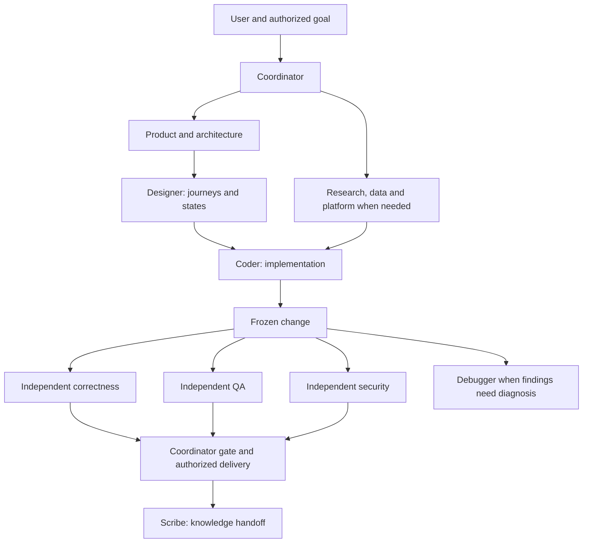

# Department map

The main session coordinates the user's authorized outcome. These are reusable role instructions, not twelve permanently running processes or separate model subscriptions. Claude receives native agent definitions; Codex receives role references inside autonomous-development and delegates through native workers. Tool connections remain recipient-specific.

| Role | Responsibility | Handoff |
| --- | --- | --- |
| frank-product | Requirements, priorities, acceptance | Brief to designer/architect/coder |
| frank-designer | UX flows, prototypes, visual system, accessibility specification | Design/state matrix to coder and QA |
| frank-architect | System boundaries, contracts, migration decisions | Contracts and common vectors to builders |
| frank-coder | Frontend/backend implementation | Changes and focused evidence to reviewers |
| frank-researcher | AI/tool research and experiment design | Sourced decisions and evaluation plan |
| frank-data | Data models, retrieval, dataset provenance | Data contracts and evaluation inputs |
| frank-platform | Development environment, CI, operational observability | Reproducible runtime and release runbook |
| frank-reviewer | Independent correctness | Findings on frozen changes |
| frank-qa | Independent tests and user-journey verification | Actual results and coverage limits |
| frank-security | Independent threat and exposure review | Reachable security findings |
| frank-debugger | Root-cause diagnosis | Reproduction and repair recommendation |
| frank-scribe | Documentation and knowledge handoff | Maintained source-backed documentation |

For a new interface: coordinator scopes the request; product clarifies acceptance if needed; designer maps journeys and states; coder implements; independent correctness, QA and security assess the frozen change. Architects, researchers, data and platform specialists join only where their responsibility is affected. Tiny layout fixes can use existing design patterns without a separate design task.

For AI research: researcher defines evidence and trial criteria; data prepares authorized inputs when needed; coder/platform build the bounded experiment; evaluation records observed quality, latency and usage. Tool availability and account access must be verified, never assumed.

Each worker receives goal, files, acceptance, context, environment, evidence location and stopping condition. Workers do not recursively delegate or publish. Keep one coordinator, bounded parallelism and one combined fix brief. Standards and security claims require scoped evidence; no role can guarantee universal 100% reliability.
